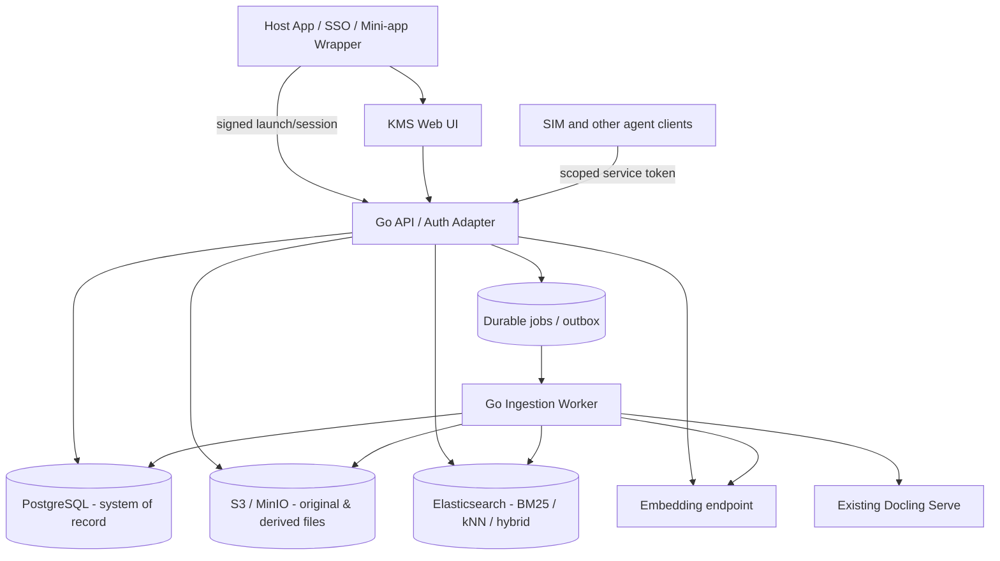

# KNOWLEDGE WORKSPACE — TECHNICAL PRD

**Version:** 1.0 • 30 October 2026  
**Status:** Engineering proposal / implementation-ready draft (not approved enterprise policy)  
**Product:** Shared Knowledge Management System (KMS) as a host-wrapped mini-app  
**Scope:** Knowledge repository, document processing, discovery/retrieval, governance and integration APIs. **Not** a new six-agent SIM system.

## 0. Executive decisions

1. **Backend:** Go for HTTP APIs, domain logic, async workers, and connectors.
2. **Relational database:** PostgreSQL is canonical for business records, metadata, ownership, ACL, lifecycle, ingestion and audit. **No pgvector.**
3. **Search:** Elasticsearch only; use BM25 and `dense_vector` kNN, with hybrid ranking/RRF if supported by the deployed Elasticsearch version/licensing.
4. **Document converter:** Existing, self-hosted **Docling Serve** accessed via Go HTTP adapter (do not start another Docling service). Preserve Markdown and structured Docling JSON, including provenance, page and table data when supplied.
5. **Embedding:** Separately deployed/integrated multilingual embedding endpoint; Docling is **not** the embedding service. Final provider/model, dimensions and language benchmark must be configured before index creation.
6. **File bytes:** S3-compatible object storage; PostgreSQL stores references and checksums, not PDFs as bytea.
7. **Runtime:** One Go API and one Go worker initially, plus frontend mini-app. Modular monolith; split services later only when warranted.
8. **UI:** Start from the supplied **Knowledge_Workspace_Navy_Cobalt.html**, preserving Navy/Cobalt styling and document-first information architecture. No standalone login page.
9. **Security:** Host handles user authentication; KMS verifies trusted identity/session and **always** performs its own resource authorization and tenant/case checks. No browser-provided user/role/tenant headers are trusted.
10. **Knowledge vs agent skill:** KMS publishes governed source material and evidence. SIM's agent skills, proposal decisions and skill release authority remain separate consumers/domains.

> **Compatibility with SIM v3.1:** The SIM PRD assumes it will not replace existing KMS/PMS/Tania. Building a new shared KMS is a separate product decision; offer federation/connectors to existing authoritative source systems rather than silently substituting their business records.

## 1. Goals, personas, scope

### Goals
- Upload, organize, search, preview, version, review and publish approved knowledge.
- Parse multi-page PDFs via existing Docling; preserve source provenance down to page/section when available.
- Offer governed hybrid retrieval to human users and AI agents with source citations, ACL and freshness.
- Allow internal business knowledge and **case-private tender knowledge** without cross-case leakage.
- Make ingestion observable, replayable, and recoverable; keep Elasticsearch an eventually consistent derived index.

### Personas
- **Reader / Consumer:** search/open knowledge permitted to them.
- **Contributor:** upload/edit metadata and submit to review within granted collections/cases.
- **Reviewer / Domain SME:** accept/reject a version with rationale and governance metadata.
- **Knowledge Steward:** manage collection ownership, classification, expiry/revalidation, publishing policy.
- **Platform Admin:** technical settings, connectors, monitoring (not automatic content approval).
- **Agent / Service Client:** bounded retrieval for specific case/service scope; not a human or universal reader.

### In scope (MVP)
Workspace/collection navigation; upload (PDF/DOCX optional); document detail and original preview; parser result; ingestion lifecycle; chunking; external embeddings; Elasticsearch keyword/semantic/hybrid search; ACL; versioning; approval/publish; source citations; case-private scoping; audit; service-to-service retrieval APIs; host-wrapper session; job status and retries.

### Outside MVP
New local username/password login; full generic AI chat assistant; LLM fine-tuning; replacing corporate CRM/PMS/Tania; new six-agent orchestration; fully automated enterprise-catalogue truth approval; public multi-customer content marketplace; automatic commercial signoff.

## 2. Mini-app authentication and authorization (explicit decision)

**Login UI: OUT. Authentication & authorization: IN.** Recommended contract:

- **Host/SSO** authenticates users (e.g., OIDC). KMS must validate tokens from a trusted issuer with signature, `iss`, `aud`, `exp`, `nbf` and key rotation; validate tenant/account membership from trusted claims/mapping.
- **Best if same-origin/host BFF:** host reverse-proxies KMS and provides a backend-verifiable session. Use secure HttpOnly cookies with CSRF protection for state-changing requests, if cookies are used.
- **If cross-origin iframe:** host backend produces a **short-lived, one-time launch code** bound to user, tenant, audience and nonce; KMS backend exchanges/verifies it server-to-server and establishes a secure session. `postMessage` may deliver **only** the launch code using exact origin and source checks, never a long-lived access token. Plan for third-party cookie blocking; if browser/host setup cannot support secure sessions in frame, prefer same-origin proxy or top-level navigation.
- Do **not** trust `user_id`, `roles`, `org_id`, `tenant_id` or case scope merely supplied in browser request body, query string, unsigned headers or `postMessage`.
- A dev-only `AUTH_MODE=mock` may exist for local development; application startup MUST refuse mock auth in production.
- Authorization is **resource-level**: tenancy, collection membership, document ACL, case scope, action, approval delegation, classification, expiry. Separate upload/edit/review/publish/admin/read privileges. No implicit reviewer self-approval where an independent review is required.
- **Service accounts** use scoped credentials and audience validation. When an agent is acting on behalf of a user, require verified delegated user context and enforce intersection of service permissions and user/case permissions.
- Browser never gets Elasticsearch, PostgreSQL, object storage administrative credentials or Docling API key.
- Define host integration contract first: embedding type (iframe/router), parent origin, cookie policy, issuer/JWKS, launch/session TTL, logout behavior and allowed routes.

**Proposed default roles:** `reader`, `contributor`, `reviewer`, `steward`, `platform_admin`. Roles alone are not enough; add explicit collection/case grants.

## 3. Architecture



**Deployables (initial):** `kms-api`, `kms-worker`, `kms-web`. PostgreSQL/Elasticsearch/S3/Docling/embedding are configured dependencies. Use a durable PostgreSQL jobs table initially or an already-approved broker; do not make Valkey/Redis the only job durability mechanism.

**Boundary rules:**
- Go API is the only public entry to search, metadata and content download; ES is private.
- `documents`/`document_versions` are canonical in PG, chunks indexed in ES are derived/rebuildable.
- Worker never grants publication/approval automatically after extraction/index success.
- API can return metadata when index is behind; ingestion/index status visible and truthful.
- Use transaction + outbox for changes that must trigger index/delete/reindex and downstream invalidation.

## 4. User journeys and functional requirements

| ID | Requirement | Priority | Acceptance / behavior |
|---|---|---|---|
| KMS-01 | Browse collections/documents | P0 | Filter/paginate by collection, owner, status, type; only authorized results. |
| KMS-02 | Upload source versions | P0 | Validate file type, size, checksum, tenant, case and classification; store original in object storage. |
| KMS-03 | Docling integration | P0 | Async job calls existing Docling Serve; persists Markdown + structured JSON, conversion errors, provenance. |
| KMS-04 | Structure-aware chunking | P0 | Preserve hierarchy, page/section/table source anchors when available; chunk IDs stable per version. |
| KMS-05 | Embedding and index | P0 | Generate external embeddings; index text, metadata, vector into Elasticsearch; dimension/model match validated. |
| KMS-06 | Search | P0 | Keyword BM25, semantic kNN, hybrid; filters tenant/case/collection/status/date; citations returned. |
| KMS-07 | RBAC/ABAC enforcement | P0 | Deny by default; server-side authorization on every read/write/search/download/export. |
| KMS-08 | Review & publish | P0 | Reviewer can approve/reject a precise document version with rationale; draft/expired status never masquerades as approved evidence. |
| KMS-09 | Document versioning | P0 | Uploading new version does not mutate previous version; approved record stays immutable; new version needs review. |
| KMS-10 | Auditing | P0 | Actor, action, timestamp, tenant, resource, before/after version, outcome; protected from ordinary user edits. |
| KMS-11 | Ingestion operational UX | P0 | Job state `queued/processing/failed/indexed`; retry and safe idempotence; searchable after policy permits. |
| KMS-12 | Agent retrieval contract | P0 | Per-call scope, citations, versions, trust status, access checks; no universal agent access. |
| KMS-13 | Knowledge expiry / withdrawal | P1 | Expired/withdrawn sources disappear from approved-evidence retrieval; dependent claims can be notified. |
| KMS-14 | Existing KMS connector | P1 | Import/federated search from approved enterprise systems with ownership/ACL/source URI retained. |
| KMS-15 | Usage and quality analytics | P1 | Index lag, ingest errors, citation coverage, zero results, review backlog, retrieval evaluation. |
| KMS-16 | Rich user AI Q&A | P2 | Separate future feature; must be retrieval-grounded and permission-aware. |

### Document lifecycle
`DRAFT → PROCESSING → READY_FOR_REVIEW → PUBLISHED → EXPIRED/ARCHIVED/REVOKED`. **Processing status** is a parallel technical state (`pending/processing/indexed/failed`), not an authorization/approval state. A document can be indexed but not eligible for approved-global retrieval. New version starts its own review and indexing workflow.

### Retrieval trust policy
- **Case-private user-provided RFP/KAK:** authorized for the case; tagged `customer_source`, can serve as tender requirement evidence but **not** proof of vendor/company capability.
- **Approved corporate knowledge:** tag `enterprise_approved`, current, scoped; eligible for agent capability claims.
- **External or unreviewed:** visible to appropriately authorized editors for discovery only, labeled unverified; not an unconditional contractual source.
- Conflicts between approved versions are returned as signals to resolve, not guessed away.

## 5. Processing pipeline / async job contract

1. **Upload:** create `document_id`, immutable `version_id`, SHA-256, storage key, MIME, owner/ACL, scope and `ingestion_job_id` in PG. Optionally scan for malware; enforce max size and PDF validation.
2. **Parse:** worker streams file from storage to **existing Docling Serve** via authenticated HTTP. Prefer async endpoint for large PDFs; persist `docling_task_id`, poll status and fetch result; store raw structured JSON and Markdown separately. Never assume all PDFs produce perfect page/table coordinates.
3. **Normalize:** reconstruct sections/headings/pages, tables, text offsets; maintain mapping `{version_id, chunk_id, page_start, page_end, section_path, source_anchor}`.
4. **Chunk:** structure-aware chunks with configurable boundaries, overlap, page metadata, deterministic IDs. Keep headings and small tables near related explanatory text; preserve table rendering as additional artifact if needed.
5. **Embed:** call configurable multilingual embedding HTTP endpoint, pin `embedding_model_id`, version and `dimensions`. Same model/version for query and indexed chunks; new model requires new ES index + reindex.
6. **Index:** bulk upsert into ES with `tenant_id`, document/version IDs, case/collection scope, classification, trust/publish state, expiry, permitted ACL projection, content, embeddings, page/heading references. **Never expose ES directly to frontend or agent.**
7. **Review / Publish:** a human reviewer approves version metadata, then a policy/index event updates searchable trust scope. Case-private documents may be searchable within their case without enterprise publish, per explicit policy.
8. **Change / Revoke:** invalidate affected index entries; on permission/withdrawal changes enforce DB authorization before returning any search hit while reindex/delete catches up.
9. **Failures:** retry with exponential backoff and bounded attempts; dead-letter/manual retry; idempotent upsert keyed by version/chunk ID; structured error logs and metrics.

**Docling integration verification:** Self-hosted instance capabilities/endpoint shape must be checked from its live `/docs` before writing the adapter. Documented Docling Serve endpoints include `POST /v1/convert/file/async`, `GET /v1/status/poll/{task_id}` and `GET /v1/result/{task_id}`; optional `X-Api-Key` when enabled. Docling and backend version differences are expected.

## 6. Elasticsearch design (NO pgvector)

### Suggested index
Name: `kms_chunks_v1` with alias `kms_chunks_current`. A chunk is the retrieval unit. Conceptual fields:

```json
{
  "chunk_id":"uuid", "tenant_id":"uuid", "document_id":"uuid", "version_id":"uuid",
  "collection_id":"uuid", "case_id":"uuid-or-null", "scope":"enterprise|case",
  "classification":"internal", "trust_status":"approved|unverified|customer_source",
  "publication_status":"published|draft|expired|revoked",
  "effective_at":"timestamp", "expires_at":"timestamp-or-null",
  "title":"string", "heading_path":["..."], "content":"text",
  "page_start":1, "page_end":2, "source_anchor":"string",
  "embedding_model_id":"string", "embedding":[0.1,0.2],
  "acl_principals":["..."], "acl_groups":["..."]
}
```

- `embedding` maps as Elasticsearch `dense_vector` with `dims` matching the selected embedding model, `index: true`, suitable similarity (`cosine` only if appropriate for model normalization) and supported index options.
- **Hybrid**: `multi_match` BM25 over `title`, `heading_path`, `content` + `knn` vector over embedding. Fuse with RRF when supported by deployed ES features; otherwise implement documented, tested dual-query reranking in Go. Do not assume RRF license/feature availability without testing.
- **Security:** prefilter `tenant_id`, scoped collection/case, publication/trust/expiry and projected ACL in **each retriever**; post-verify hit resource permissions against authoritative PG policy before returning snippets/URLs. This reduces eventual ACL-reindex exposure.
- Return citation metadata and `index_version`. Use alias swap for embedding migrations and reindex without downtime; implement purge for deletion/retention requests.
- Never store raw restricted costs or customer data in a globally searchable index; use scopes and data classification.

### Search response minimum
`chunk_id, document_id, version_id, title, snippet, page_start/page_end, section_path, source_type, trust_status, effective_at, expires_at, citation, relevance_score, matched_reason, indexing_timestamp`.

## 7. PostgreSQL logical data model

Recommended tables (normalize/adjust in implementation):

- `organizations`, `users`, `host_identities`, `organization_memberships`, `service_clients`.
- `roles`, `permissions`, `user_role_assignments`, `resource_grants`, `case_memberships`.
- `collections`, `collection_memberships`.
- `documents` (logical), `document_versions` (immutable source versions), `document_files` (object references), `document_metadata`.
- `document_reviews`, `review_decisions`, `publication_events`.
- `ingestion_jobs`, `ingestion_attempts`, `parser_artifacts`, `chunks` (metadata, text/anchor if needed for recoverability), `embedding_models`, `index_operations`.
- `knowledge_sources`, `evidence_records`, `evidence_claim_links` (optional SIM-related association through integration contract).
- `search_queries` (redacted/aggregated where sensitive), `audit_events`, `outbox_events`.

Each tenant-owned row contains `tenant_id`; each case-private resource carries `case_id`, classification and visibility. Every document version has `checksum`, `original_object_key`, `parser_status`, `index_status`, `review_status`, `reviewed_by/at`, `valid_from`, `expires_at`. Persist source reference URIs for imported records. Design DB uniqueness and tenant-scoped indexes; enforce foreign-key integrity.

## 8. REST API v1 proposal

All endpoints are under `/api/v1`, with authenticated context from wrapper/SSO. Never accept client-supplied tenant or user IDs as authority.

| Method | Endpoint | Purpose | Required role/scope |
|---|---|---|---|
| GET | `/session` | Current verified user, tenant, capabilities | Any signed-in |
| GET/POST | `/collections` | List/create collections | Reader / Steward |
| GET/PATCH | `/collections/{id}` | Detail/update policy | Reader / Steward |
| GET/POST | `/documents` | Browse/upload source | Reader / Contributor |
| GET | `/documents/{id}` | Detail and versions | Authorized reader |
| POST | `/documents/{id}/versions` | Upload new version | Scoped contributor |
| GET | `/documents/{id}/versions/{versionId}/preview` | Secured preview/short-lived URL | Authorized reader |
| GET | `/documents/{id}/ingestion` | Ingest/parse/index status | Scoped reader |
| POST | `/documents/{id}/reprocess` | Re-run parser/index | Steward / Admin |
| POST | `/documents/{id}/submit-review` | Request version review | Contributor |
| POST | `/reviews/{reviewId}/approve` | Review a precise version | Delegated reviewer |
| POST | `/reviews/{reviewId}/reject` | Reject with rationale | Delegated reviewer |
| POST | `/search` | Keyword/semantic/hybrid search | Authenticated reader with ACL |
| POST | `/retrieval/query` | Agent/service retrieval with citations | Scoped service client / delegated user |
| GET | `/activity` | Activity/audit view | Scoped reader/auditor |
| GET | `/healthz`, `/readyz` | Liveness/readiness | Internal ops |

**Search request example** (not authoritative identity):

```json
{
  "query":"on-prem video retention 30 days",
  "mode":"hybrid",
  "collection_ids":["collection-uuid"],
  "case_id":"case-uuid-or-null",
  "top_k":10,
  "include_unverified":false
}
```

Backend determines verified tenant/user/service and computes permissible scope. Sensitive fields and cost data excluded unless explicitly delegated. Use standard error envelope with code, message, correlation ID, retryable flag; pagination via cursor.

## 9. UI / screens

Use **Knowledge_Workspace_Navy_Cobalt.html** as the UI reference (not production API logic). Maintain high contrast: navy sidebar, cobalt actions, white content panes, subtle glass only on nonessential surfaces. Responsive desktop and mobile.

1. **Overview:** knowledge counts, review queue, ingestion health, recent documents.
2. **Library:** searchable/filterable document table, status, owner, version, expiry, collection, access scope.
3. **Document Details:** original PDF preview, parsed text/sections, metadata, version history, citations, grants, review timeline.
4. **Collections:** create/edit, ownership and sensitivity.
5. **Review Center:** pending review, version diff, approve/reject with rationale.
6. **Search / Ask Knowledge:** keyword/semantic/hybrid toggle, filters, relevant excerpts with clickable page citations. Do not label retrieval as generated AI answers.
7. **Ingestion Jobs:** progress/status, parse errors, retries and source health.
8. **Audit / Settings:** role-appropriate audit access; integration status, no raw secrets.

**Wrapper behavior:** no login screen; show session loading, 401/not-authorized state, session-expired/return-to-host action. Do not fake production authentication via localStorage.

## 10. Non-functional / security requirements

- Signed token/session validation, deny-by-default, per-resource checks, no public ES/Docling/admin endpoints, strict CORS and allowed iframe parent origins with CSP `frame-ancestors`.
- Avoid transmitting access tokens in URLs. Use `HttpOnly; Secure` cookies if appropriate and protect state changes against CSRF. Prevent XSS and direct-download bypass.
- Encrypt in transit; restrict object storage keys and use short-lived signed URLs only after authorization. Enforce file MIME/size quotas and malware scanning as policy requires.
- Document content is **untrusted data**; never interpret PDF text as instructions for agents, server actions, permissions or system prompts.
- Observability: structured logs with request ID/tenant (without leaking private content), traces, Docling timings, embedding latency, ES index backlog, failed-job metrics and audit events.
- Target performance values must be benchmarked with representative tenders; collect p50/p95 search latency, ingest throughput, retrieval quality and citation accuracy instead of inventing production SLAs.
- Backup PostgreSQL and object storage; Elasticsearch indices must be rebuildable from canonical data. Support deletion/retention policies with Legal/Security.

## 11. Engineering acceptance tests (BDD-style)

1. **Upload → search:** Given authorized contributor uploads a PDF, when Docling parses, chunks embed and index, then authorized search returns page-linked citations and original preview works.
2. **Case isolation:** Given user A has only Case A permission, when searching for Case B text (including semantically similar query), then no Case B snippet, metadata or URL is returned.
3. **Unverified guardrail:** Given a source is Draft, when normal agent queries approved capability evidence, then the source is excluded or explicitly unverified (never presented as approved fact).
4. **Version and approval:** Given an approved V1 and uploaded V2, when V2 parses successfully, then V1's approval does not automatically approve V2.
5. **Revocation:** Given a source access grant is revoked, when search index still has its old ACL, then KMS post-check denies output while async reindex removes stale projection.
6. **PDF limitations:** Given Docling cannot extract table cells or page anchors, when conversion completes, then the document is marked partial/needs review; citations do not invent page numbers.
7. **Idempotent retry:** Given network failure after ES bulk upsert, when worker retries same version/chunk, then duplicate chunks are not created.
8. **Embedding migration:** Given a new model with different dimensions, when migration starts, then a new index is built; queries and docs never mix incompatible vectors.
9. **Wrapped auth:** Given no verified host session, when direct browsing KMS API, then HTTP 401; forged browser tenant headers do not grant access.
10. **Approval separation:** Given contributor is not delegated to approve, when posting `approve`, then HTTP 403 and audit event; no publication.
11. **Deletion:** Given a document is deleted/revoked, when search executes, then it cannot be retrieved and background index cleanup is tracked.
12. **Agent audit:** Given an agent service retrieves knowledge, then trace records service ID, delegated user/case context where applicable, source/version IDs and policy decision.

## 12. Delivery slices / build order

- **S0 — Integration contracts:** inspect existing Docling `/docs`, Elasticsearch deployed version + license, embedding endpoint/model, object storage, wrapper/SSO mode. Sign off roles, source classification, tenant/case semantics.
- **S1 — Reliable foundation:** Go API, PostgreSQL migrations, host Auth Adapter (mock only in local), collections, documents, S3 files, Docling adapter, persistent ingestion job, UI shell.
- **S2 — Search:** structural chunking, embedding adapter, ES mappings/index alias, BM25 + kNN + hybrid, ACL tests, search UI and citations.
- **S3 — Governance:** review/publish, version diff, expiry/revocation, audit, role-based UI, agent retrieval endpoints and integration tests.
- **S4 — Operational readiness:** resiliency, metrics, retention, existing-KMS connectors, retrieval evals, tuning/performance and documentation.

**Definition of Done:** `go test ./...` and security/integration tests pass; migrations repeatable; `docker compose up` can start local dependencies other than already-available Docling if desired; README documents `.env` and external Docling/embedding URLs; frontend has no login page and no hidden dependency on mock data in production; every API checks auth and tenant scope; search citations map to stored versions.

## 13. Open decisions — confirm before irreversible implementation

- What exactly is the **host wrapper**: same-origin routed mini-app, iframe, or independent tab? Identity issuer/JWKS? Session cookie support?
- Which Elasticsearch version and subscription/features are deployed? Is native RRF retriever supported?
- Which multilingual embedding model/provider, vector dimension and expected Indonesian/English search corpus?
- Docling Serve **base URL/version/API key**, conversion size limits, output formats, actual page anchors; inspect `/docs` on the running instance.
- Object storage bucket, encryption, retention and malware scanning requirements.
- Collection access policy and required tenant/customer/case isolation; official catalogue ownership and who can publish.
- Required file types beyond PDF for MVP; whether import of an existing KMS must ship in first release.

## 14. Verified external references

- Docling Serve REST: https://docling-project.github.io/docling/usage/api_server/rest_api/
- Elasticsearch vector / kNN: https://www.elastic.co/docs/solutions/search/vector/knn
- Elasticsearch hybrid RRF: https://www.elastic.co/docs/reference/elasticsearch/rest-apis/reciprocal-rank-fusion
- Elasticsearch official Go client: https://www.elastic.co/docs/reference/elasticsearch/clients/go
- OWASP Micro Frontend Security: https://cheatsheetseries.owasp.org/cheatsheets/Micro_Frontend_Security_Cheat_Sheet.html
